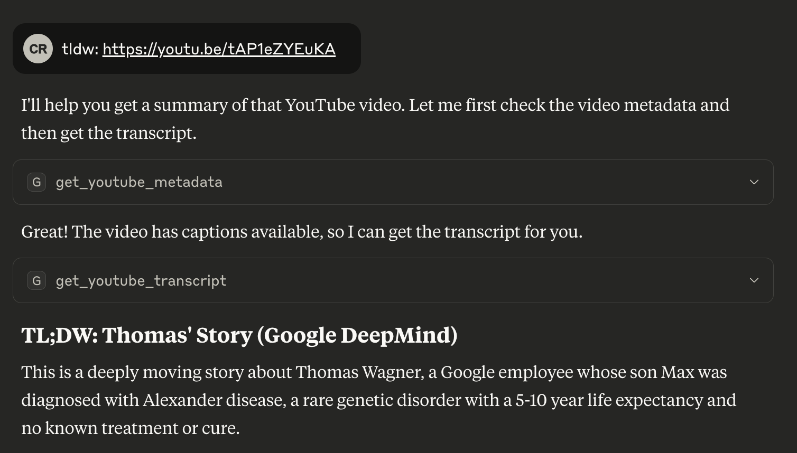
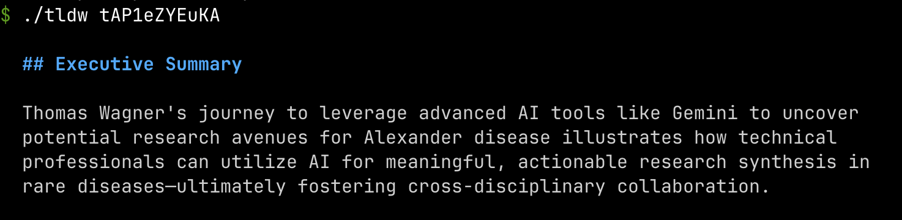

# tldw - too long; didn't watch

Summarize YouTube videos and playlists or public X posts containing one video using GPT-6 Luna
by default. Works with existing captions (free) or paid OpenAI transcription (`gpt-transcribe`).
Includes an MCP server for Claude and other AI assistants and a CLI.

See [docs/architecture.md](docs/architecture.md) for the project structure and
dependency direction.

## Installation

```bash
brew install rtzll/tap/tldw
export OPENAI_API_KEY="your-api-key-here"  # optional: for AI summaries & paid transcription
```

## MCP

`tldw mcp` accepts YouTube and X video links through its existing tools:

- **`get_youtube_metadata`**: Video metadata and captions status
- **`get_youtube_transcript`**: Free video captions transcript
- **`transcribe_video_paid`**: Paid OpenAI transcription

`get_youtube_transcript` accepts `include_timestamps=true` to return caption
lines with timestamps when timing data is available.

### Claude Desktop Setup

**Easy setup:**

```bash
tldw mcp setup-claude
```

This automatically configures Claude Desktop to use tldw. Restart Claude Desktop
afterward.

**After setup**, ask Claude: _"tldw: https://youtu.be/tAP1eZYEuKA"_



### ChatGPT Setup

Use OpenAI Secure MCP Tunnel to connect ChatGPT to your local `tldw mcp` without
exposing a public server.

Install the OpenAI tunnel client with Homebrew:

```bash
brew install openai/tools/tunnel-client
tunnel-client --version

export CONTROL_PLANE_API_KEY="sk-..."   # OpenAI runtime API key
export TLDW_TUNNEL_ID="tunnel_..."      # From Platform tunnel settings

just tunnel-init
just tunnel-doctor
just tunnel-run
```

The ChatGPT tunnel setup uses local HTTP MCP by default:

- `tldw mcp --transport=http` listens on `127.0.0.1:8765`
- `tunnel-client` keeps its own health/UI listener on `127.0.0.1:8080`

Override the MCP host or port with `TLDW_MCP_HTTP_HOST` or `TLDW_MCP_HTTP_PORT`
before `just tunnel-init`. For an existing profile, use `just tunnel-update` to
edit its MCP URL and health address in `$VISUAL` or `$EDITOR`; the client
validates the profile before the background service is reinstalled. Existing
settings are not force-replaced.

Profiles use `TLDW_TUNNEL_PROFILE_DIR`, then `TUNNEL_CLIENT_PROFILE_DIR`, then
`$XDG_CONFIG_HOME/tunnel-client` (or `~/.config/tunnel-client`). The same
directory is used by the foreground commands and launchd.

Then open ChatGPT > Settings > Connectors > Create, choose **Tunnel**, and
select or paste the tunnel ID. Keep `just tunnel-run` running while using the
connector.

Optional: `just tunnel-launchd-install` stores the runtime key in Keychain and
starts both the local HTTP MCP server and the tunnel at login. After upgrading
`tldw` or running `brew upgrade openai/tools/tunnel-client`, run
`just tunnel-launchd-restart` so launchd starts the new binary. Set
`TLDW_TUNNEL_CLIENT` only when using a non-Homebrew tunnel-client binary.

Tip: Put recurring summary prompts in a ChatGPT Project, then enable the `tldw`
connector in chats from that Project.

### Diagnose a failed request

Set `mcp_log_enabled = true` in `config.toml` and restart the MCP server.
With the launchd tunnel, run `just tunnel-launchd-restart`. Each failed tool
call includes a `trace_id`. Look it up in `mcp.log` in the cache directory
shown by `tldw paths`. On macOS with the default cache location:

```bash
id='paste-the-32-character-trace-id-here'
log="$HOME/Library/Caches/tldw/mcp.log"
jq -Rc --arg id "$id" 'fromjson? | select(.trace_id == $id)' "$log"
```

| What you see | What happened |
| --- | --- |
| An HTTP arrival and response, with no `tools/call` span | The request reached the listener. Check the HTTP status, route, and any linked MCP trace. Discovery and initialization also stop here. |
| `yt-dlp.captions` ends with `http.response.status_code = 429` | This subprocess observed the rate limit. Its parent `youtube.fetch` records the attempt and cooldown. |
| `yt-dlp.captions` ends with `error.type = empty_caption_response` | yt-dlp received no caption bytes. If the first two YouTube downloads both return empty, tldw waits 10 seconds and tries once more in the same call. Each `captions.acquire` span records its attempt number. |
| `youtube.read` has a `cooldown.deferred` event | The remaining cooldown exceeded this request’s wait budget. Follow `links[].trace_id` and `span_id` to the fetch that established the deadline. |
| A local `span.start` has no matching `span.end` | That stage started. It may still be running, or the process or log may have been interrupted. |

Each completed YouTube `yt-dlp.captions` span includes
`tldw.caption.player_client`. It identifies which player supplied the selected
subtitle URL (`web` or `android`). A value of `unknown` means yt-dlp did not
identify a recognized client. Compare this field across successful and failed
attempts for the same video.

`just tunnel-launchd-logs --tail` follows the tunnel logs and the local MCP
trace file when present. If there is no HTTP arrival around a failure, check
the server startup record and the tunnel logs for the same time window.
A downloader error includes its exit code and HTTP status when available.
An unrecognized diagnostic is labeled `process_failed`. The trace omits raw
command output, full URLs, prompts and transcripts.

To trace one CLI invocation, set `TLDW_TRACE_LOG` to an append-only JSON lines
file. This also works as a path override for MCP.

```bash
TLDW_TRACE_LOG="$PWD/tldw-trace.jsonl" tldw transcribe tAP1eZYEuKA
```

For a trace viewer, set `OTEL_EXPORTER_OTLP_ENDPOINT=http://127.0.0.1:4318`
in the environment of the CLI or MCP process to send the same spans over
OTLP/HTTP. For a custom trace URL, use `OTEL_EXPORTER_OTLP_TRACES_ENDPOINT`
with the full path, including `/v1/traces`. Search the viewer for the trace
ID or the service `tldw`. A local file works independently of the collector.
[OTLP endpoint configuration](https://opentelemetry.io/docs/languages/sdk-configuration/otlp-exporter/)

## CLI

### Usage Examples

#### Single Videos

```bash
# Get transcript (free with captions)
tldw transcribe "https://youtu.be/tAP1eZYEuKA"
tldw transcribe "https://x.com/AmpCode/status/2123051353505443912"
tldw transcribe tAP1eZYEuKA -o transcript.txt  # Save to file
tldw transcribe tAP1eZYEuKA --timestamps       # Include caption timestamps
tldw transcribe tAP1eZYEuKA --allow-paid-transcription # Use paid transcription if captions are unavailable

# Copy transcript to clipboard
tldw cp "https://youtu.be/tAP1eZYEuKA"
tldw cp tAP1eZYEuKA --allow-paid-transcription        # Copy the transcript with the same paid fallback

# Generate summary with GPT-6 Luna (requires API key)
tldw "https://youtu.be/tAP1eZYEuKA"
tldw tAP1eZYEuKA -m gpt-6-luna -p "tldr: {{.Transcript}}"

# Get video metadata
tldw metadata "https://youtu.be/tAP1eZYEuKA"
tldw metadata tAP1eZYEuKA -o metadata.json   # Save to file
tldw metadata tAP1eZYEuKA --pretty           # Format JSON output
tldw metadata tAP1eZYEuKA --refresh          # Bypass metadata caches

# Show unique-video stats from the local metadata library
tldw stats
tldw stats --period month
tldw stats --period month --group-by day
tldw stats --period week --json
```

### Using tldw in scripts

Results go to stdout. Prompts, progress, and verbose logs go to stderr.
Piping a summary produces plain Markdown. For version information use
`tldw --version` or `tldw version`. Both work before configuration.
`-v` enables verbose output.

Summaries ask for paid transcription only when stdin and stderr are terminals.
Use `--non-interactive` to disable prompts. CI also disables them. To authorize
paid fallback explicitly, pass `--allow-paid-transcription`. Each playlist
prompt covers one video. Redirecting stdout alone still allows a terminal prompt.

| Exit code | Meaning |
| --- | --- |
| `0` | Success, including an empty statistics report |
| `1` | Operational failure or partial result |
| `2` | Invalid arguments or required confirmation unavailable |
| `130` | Ctrl+C or declining a confirmation required to finish |
| `128 + signal` | Termination by signal, e.g. `143` for SIGTERM on Unix |

`metadata` and `stats --json` return a JSON error on stderr with `status`,
`reason`, and `message`. A partial `stats --json` report returns its available
totals, `incomplete: true`, and `warnings` on stdout and exits `1`. A partial
playlist also exits `1`, with its summary on stdout and skipped videos on stderr.
With prompts disabled and no paid opt-in, tldw summarizes the videos with
available captions. If every video needs paid transcription, it exits `2`
and explains how to authorize it.

For `metadata` and `transcribe`, `-o -` writes to stdout. A named output
file is published atomically after the command succeeds. Earlier versions
overwrote existing files. Scripts that intentionally replace an existing
regular file must now pass `--force`. New exports have owner-only permissions
on Unix. Replacements preserve the file's permission bits. Use `-o ./-` for
a file literally named `-`.

`tldw stats` reports the runtime of unique videos in the local metadata library.
Supported periods are `today`, `week`, `month`, and `all`; grouped reports can
use `day`, `week`, or `month`.

Caption downloads prefer original English automatic captions, then manual
English captions, then a direct track in another language. Each download
requests one track. Automatically translated captions are excluded.

When YouTube rate-limits a metadata or caption fetch, tldw shares a cooldown
across those reads in the running process. It honors a `Retry-After` delay
reported by yt-dlp. Otherwise the cooldown starts at about 10 seconds and
doubles on repeated failures, up to two minutes. One request checks whether
YouTube has recovered when the cooldown expires. Each call can retry once and
spend up to 20 seconds waiting for recovery, subject to its own deadline.
Longer waits return a suggested retry time. Cached results remain available.
With tracing enabled, attempts have separate durations and outcomes. Cooldown
events record the time spent waiting or the budget that forced a deferral.
X/Twitter reads run independently, and a caption rate limit never triggers
paid transcription.

Negative caption metadata expires after 15 minutes. Before falling back to paid
transcription, tldw checks cached negative metadata again. A failed
recheck returns an error. On both YouTube and X, automatic paid fallback requires
confirmed caption absence. Download, file-read, and subtitle-parsing failures
return their underlying errors.

### Transcription smoke test

Run the opt-in end-to-end check with:

```bash
just smoke-transcription
```

It builds `tldw`, transcribes the README video through both the CLI and the HTTP
MCP `get_youtube_transcript` tool, and verifies that their timestamped outputs
match. It also checks two single-video X posts with a cold cache per transport.
The captioned post must produce matching text. The uncaptioned post must return
paid opt-in guidance. These checks use free captions, isolated temporary XDG
directories, `yt-dlp`, and network access. Set `TLDW_SMOKE_VIDEO_URL` to change
the YouTube fixture.

#### Playlists

```bash
# Summarize entire playlist (use an explicit playlist URL)
tldw "https://youtube.com/playlist?list=PLSE8ODhjZXjYDBpQnSymaectKjxCy6BYq"

# URLs with a video ID and list parameter are treated as that single video
tldw "https://youtu.be/tAP1eZYEuKA?list=PLSE8ODhjZXjYDBpQnSymaectKjxCy6BYq"
```

**Note:** Playlist support is currently for summaries. Transcript and metadata
commands accept individual videos.

### Example Output

Summaries are shown as markdown and rendered in the terminal.



## Configuration

Either edit the config file or use environment variables.

GPT-6 Luna (`gpt-6-luna`) is the default summary model. Missing or blank model
settings use this default. To select a supported model explicitly, use `--model`,
`TLDW_TLDR_MODEL`, or `tldr_model` in the config file, in that order of precedence.
Unsupported explicit model selections produce an error.

### Config file

**Find your config location:**

```bash
tldw paths  # Shows config, data, and cache directories
```

**Edit config file: `config.toml`**

```toml
openai_api_key = "your-key"
tldr_model = "gpt-6-luna"
transcription_timeout = "10m"
prompt = "tldr: {{.Transcript}}"
```

or edit the `prompt.txt` file in the config directory to change the default
summary prompt.

### Environment variables

```bash
export OPENAI_API_KEY="your-key"
export TLDW_TLDR_MODEL="gpt-6-luna"
export TLDW_PROMPT="tldr: {{.Transcript}}"
```
